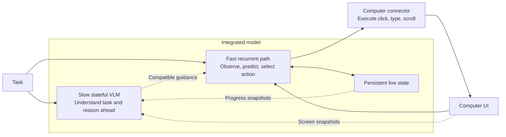
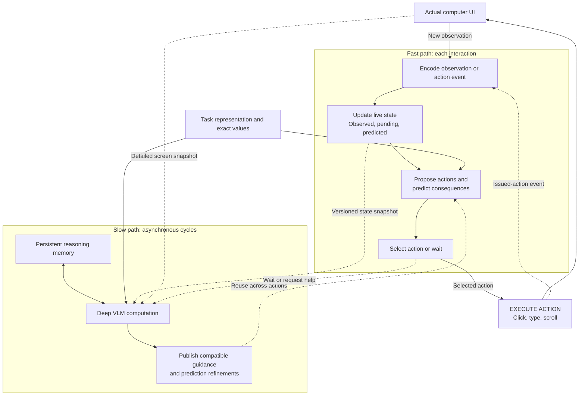

# ComputerLM v1 architecture

Status: agreed research direction through 21 October 2026; not an implemented or validated model.

## Objective and decisions

Solve easy and medium computer tasks as quickly as possible while preserving strong task success. The primary comparison is end-to-end completion time at a matched success rate. Large-path computation may run most of the time; it must not starve the action path.

Accepted decisions:

- One integrated model with independently executable fast and slow paths and learned communication.
- Persistent state and short action-conditioned prediction are part of the model from the start.
- Option B for the slow path: preserve a pretrained VLM backbone and add learned state, memory, and guidance interfaces.
- The fast path owns the latest live UI belief state and updates at interaction speed.
- The slow path has persistent reasoning memory and consumes new events at defined computation boundaries.
- Routine actions proceed using the latest compatible guidance. Uncertainty or unexpected changes can trigger a wait.
- Start with short, normally one-transition lookahead. Deep branching search is outside the initial scope.
- Recurrence across time is required. Replacing the backbone with shared recurrent-depth layers is not yet a decision.

Prediction quality, success gains, latency gains, and architectural novelty remain hypotheses to test. This is analogous to speculative execution but does not inherit the exact verification guarantees of speculative token decoding.

## High-level view

## Components

| Component | Responsibility | Key constraint |
| --- | --- | --- |
| Task encoder | Represent goal, constraints, subgoal, and completion conditions compactly. | Preserve access to the original instruction and exact values. |
| Lightweight observation encoder | Produce current visual features for the fast path; use detailed regions when needed. | Fast actions must not depend on a complete large VLM pass. |
| Action/event encoder | Encode issued actions, executor status, new observations, and timing/version information. | An issued click does not prove the intended application change occurred. |
| Fast recurrent state updater | Reconcile previous belief, action-conditioned prediction, and actual observation. | Own confirmed live state; keep observations and hypotheses distinguishable. |
| Candidate and transition heads | Propose actions and predict compact next-state representations conditioned on each candidate. | Keep branching and computation bounded; predictions must affect selection. |
| Action head and wait gate | Select action type, grounded target, arguments, or wait/request help. | Text entry requires exact payload access or a text decoder. |
| Slow VLM backbone | Interpret unfamiliar situations, resolve difficult decisions, and reason ahead. | Read current state at explicit cycle boundaries; avoid blocking routine actions. |
| Slow recurrent memory | Retain task-relevant history, unresolved issues, and useful intermediate reasoning. | A bounded learned memory is not guaranteed to preserve every detail. |
| Guidance and prediction outputs | Publish learned compact subgoal, constraint, and prediction representations. | Condition the fast path directly; long prose plans are not required per action. |
| Compatibility gate and runtime | Associate outputs with their source state/action history; adopt, revise, discard, or wait. | Stale reasoning cannot overwrite newer observed facts. |
| Computer connector | Capture observations and execute selected mouse/keyboard operations. | Keep execution feedback distinct from semantic task success. |

## Detailed action and reasoning loops

The predictor is used twice: before selection to compare likely consequences, and after an action is issued to prepare likely next-step features while the application responds. Actual observations validate or correct that preparation before a dependent action is executed.

## State and ownership

State is learned, but runtime metadata and exact values need not be latent. The following are logical responsibilities, not a fixed tensor schema or guaranteed semantic partition of hidden dimensions.

| State | Writer | Readers |
| --- | --- | --- |
| Latest observed UI facts and current belief | Fast observation/state updater | Both paths |
| Issued actions, executor status, sequence IDs | Computer connector/runtime | Both paths |
| Short predicted next states and prepared features | Fast transition block; slow refinements adopted when compatible | Fast action head and slow path |
| Goal and task constraints | Initial task encoding; controlled progress updates | Both paths |
| Persistent reasoning memory | Slow path | Slow path; selected content through guidance |
| Guidance with source version and applicability | Slow output interface plus compatibility checks | Fast path |
| Exact text, filenames, URLs, and relevant evidence | Input/observation records | Both paths through retrieval/copy interfaces |

Use detailed recent context alongside compressed older memory. Retain access to original task instructions because compact guidance can omit important constraints.

## Recurrence and always-on operation

Conceptually, the fast update is `previous state + observation + last action -> updated state`. The slow update is `previous memory + state snapshot + task -> updated memory + guidance`.

Both carry learned state across time. Visual encoders and output heads can remain feedforward. Repeatedly applying shared layers within one inference is a separate recurrent-depth design choice. A standard KV cache alone is not the proposed learned, editable task-state memory.

Always-on means a resident model session with persistent state and an event-driven reasoning loop. The slow path performs bounded cycles and can continue working while the fast path acts. It can also wait without losing state when further reasoning would not help. Weights remain fixed during normal inference.

New events can be accepted quickly by the small updater. Deep interpretation still takes compute. A forward pass already in progress cannot retroactively consume a new event; the next supported boundary consumes it and may revise unfinished reasoning. Inserting fresh evidence may invalidate cached computation, so cache reuse needs explicit rules.

## Submit example

1. Current observation confirms the form and Submit target. The action head chooses Submit based on the task, live state, and expected effects.
2. The connector issues the click and records an action event. Live state marks the result pending.
3. The fast transition block prepares likely confirmation or validation-error outcomes. The slow path consumes the event at its next boundary and reasons about the remaining task.
4. The next actual observation confirms success, exposes an error, or indicates the application is still loading.
5. The updater corrects the belief and discards incompatible preparation. The next target is grounded in the actual UI.
6. Fast execution continues if guidance is applicable; otherwise it waits for observation or deeper help. A timeout is not proof that the click succeeded or that retrying is appropriate.

## Synchronization rules

- Tag observations, actions, predictions, and slow outputs with source sequence/version metadata.
- Adopt guidance only when its assumptions remain compatible with the current state and intervening actions. An older output may still be useful; age alone is not a complete validity test.
- Keep confirmed facts separate from speculative futures. Observation correction takes priority.
- Continue, adopt guidance, and wait are separate decisions. The gate does not merely choose which model runs.
- Pause at unresolved prerequisites, unexpected transitions, large prediction errors, or uncertainty requiring deeper reasoning.
- Protect fast-path compute and memory bandwidth. Asynchronous scheduling alone does not guarantee low latency on a shared accelerator.

## Open implementation choices

- Backbone: compare editable dense VLMs, hybrid recurrent VLMs, and GUI-specialized checkpoints. Qwen3-VL-8B, Qwen3.5-9B, and UI-TARS-1.5-7B were examples considered, not a final selection or current leaderboard claim.
- Fast module: a few reused/shared VLM blocks versus a narrower custom recurrent controller. Reused late blocks need appropriate input adaptation and training; their original inputs were already deeply processed.
- Degree of parameter sharing, latent widths, memory capacity, and prediction representation.
- Screenshot-only versus accessibility-assisted observation contract. Evaluate methods under the same contract.
- Text entry mechanism, confidence calibration, compatibility checks, and observation readiness policy.
- GPU layout, scheduling, cycle boundaries, and model serving implementation.

See the [implementation plan](implementation-plan.md) and [research map](research.md).
