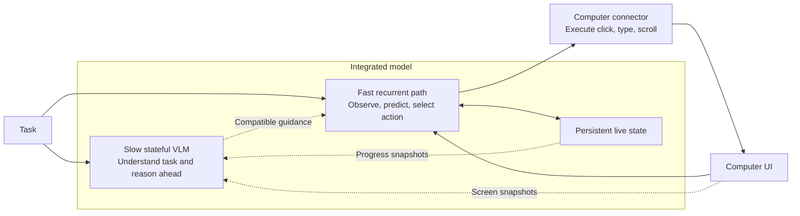
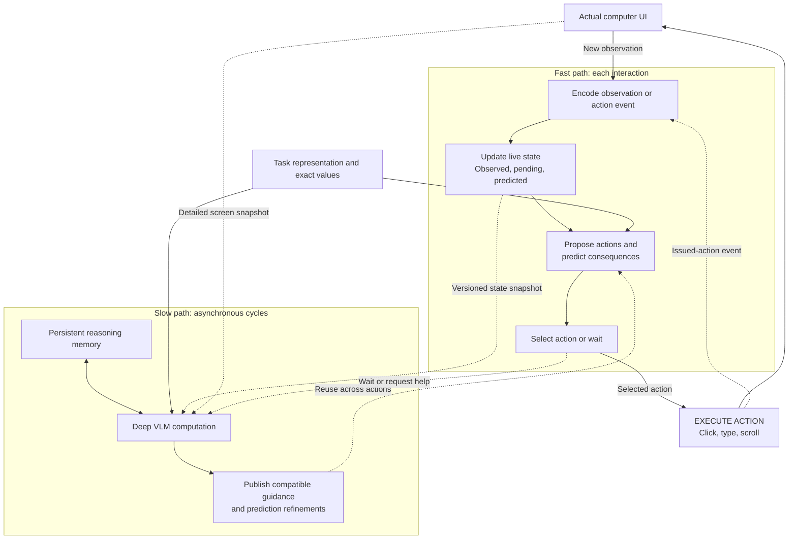

# ComputerLM v1 architecture

Status: public design consolidated 10 November 2026 from the current development proposal. A cache-free text-core prototype exists in ongoing development; the full integrated trained model and performance gains remain unvalidated. This document specifies intended behavior, not completed capabilities.

## Objective and decisions

Complete easy and medium computer tasks faster and more cheaply while preserving comparable task success. Compare end-to-end completion time, total computation and cost at matched success. Large-path computation may run throughout an active task, but its cost must be included and it must not starve the action path. Lower latency alone does not establish lower computation. See the [research proposal](research-proposal.md) for the motivation and evaluation framing.

Accepted decisions:

- One integrated model with independently executable fast and slow paths and learned communication.
- Persistent state and short action-conditioned prediction are part of the model from the start.
- Slow-path backbone: adapt Qwen3.8-27B with an encoder, shared recurrent middle blocks and a decoder/readout. This supersedes the earlier input/output-interface-only implementation choice. Preserve pretrained weights where possible, then train latent recurrence and task/state/memory/guidance interfaces.
- The fast path owns the latest live UI belief state and updates at interaction speed.
- The slow path has persistent reasoning memory and consumes new events at defined computation boundaries.
- Routine actions proceed using the latest compatible guidance. Uncertainty or unexpected changes can trigger a wait.
- Guidance covers the current subgoal and bounded contingencies; explicit deep branching search remains outside the initial scope.
- The slow path uses latent depth updates without generated thinking tokens and computes throughout an active task. Publishing guidance or advising the executor to wait does not halt it. The harness or a model completion declaration controls task-level stopping.
- Initial memory persists within one task, including pause/resume, and resets for unrelated tasks. Later live observations use screenshots plus available UI/accessibility text. Fast-path implementation is deferred while the slow core is tested.

Prediction quality, success gains, latency gains, compute/cost savings, and architectural novelty remain hypotheses to test. This is analogous to speculative execution but does not inherit the exact verification guarantees of speculative token decoding.

## High-level view

## Components

| Component | Responsibility | Key constraint |
| --- | --- | --- |
| Task encoder | Represent goal, constraints, subgoal, and completion conditions compactly. | Preserve access to the original instruction and exact values. |
| Lightweight observation encoder | Produce current visual features for the fast path; use detailed regions when needed. | Fast actions must not depend on a complete large VLM pass. |
| Action/event encoder | Encode issued actions, executor status, new observations, and timing/version information. | An issued click does not prove the intended application change occurred. |
| Fast recurrent state updater | Reconcile previous belief, action-conditioned prediction, and actual observation. | Own confirmed live state; keep observations and hypotheses distinguishable. |
| Candidate and transition heads | Propose actions and predict compact next-state representations conditioned on each candidate. | Keep branching and computation bounded; predictions must affect selection. |
| Action head and wait gate | Select action type, grounded target, arguments, or wait/request help. | Text entry requires exact payload access or a text decoder. |
| Slow VLM backbone | Interpret unfamiliar situations, resolve difficult decisions, and reason ahead. | Read current state at explicit cycle boundaries; avoid blocking routine actions. |
| Slow recurrent memory | Retain task-relevant history, unresolved issues, and useful intermediate reasoning. | A bounded learned memory is not guaranteed to preserve every detail. |
| Guidance and prediction outputs | Publish learned compact subgoal, constraint, and prediction representations. | Condition the fast path directly; long prose plans are not required per action. |
| Compatibility gate and runtime | Associate outputs with their source state/action history; adopt, revise, discard, or wait. | Stale reasoning cannot overwrite newer observed facts. |
| Computer connector | Capture observations and execute selected mouse/keyboard operations. | Keep execution feedback distinct from semantic task success. |

## Detailed action and reasoning loops

The predictor is used twice: before selection to compare likely consequences, and after an action is issued to prepare likely next-step features while the application responds. Actual observations validate or correct that preparation before a dependent action is executed.

## State and ownership

State is learned, with explicit records of confirmed goals, constraints, exact values and evidence references alongside the learned representations. Keep these records synchronized through source-linked updates; explicit bookkeeping does not replace latent reasoning. This stage 3 choice was confirmed on 25 October 2026. The following are logical responsibilities, not a fixed tensor schema or guaranteed semantic partition of hidden dimensions.

| State | Writer | Readers |
| --- | --- | --- |
| Latest observed UI facts and current belief | Fast observation/state updater | Both paths |
| Issued actions, executor status, sequence IDs | Computer connector/runtime | Both paths |
| Short predicted next states and prepared features | Fast transition block; slow refinements adopted when compatible | Fast action head and slow path |
| Goal and task constraints | Initial task encoding; controlled progress updates | Both paths |
| Persistent reasoning memory | Slow path | Slow path; selected content through guidance |
| Guidance with source version and applicability | Slow output interface plus compatibility checks | Fast path |
| Exact text, filenames, URLs, and relevant evidence | Input/observation records | Both paths through retrieval/copy interfaces |

Use bounded detailed recent context alongside learned memory, with retrieval access to older evidence in the full within-task episode log. Do not resend the entire growing history on each refresh. Retain access to original task instructions because compact guidance can omit important constraints. This access policy was confirmed on 25 October 2026; context budgets and retrieval mechanics remain implementation choices.

## Recurrence and always-on operation

Conceptually, the fast update is `previous state + observation + last action -> updated state`. The slow update is `previous memory + state snapshot + task -> updated memory + guidance`.

Both carry learned state across time. The selected slow path also repeatedly applies shared middle layers to continuous hidden representations. Visual encoders and output heads can remain feedforward. Native KV/Gated DeltaNet caches are not the proposed semantic task-state memory. The first reference disables caches between depth passes; reuse requires separate correctness evidence.

Always-on means continuous slow computation throughout an active task, with persistent state and events consumed at the next completed latent step. Publication is adaptive and does not end deliberation. An executor wait is distinct from an explicit harness pause/cancel or the model declaring completion. Explicit pause/resume preserves task state. Weights remain fixed during normal inference.

New events can be accepted quickly by the small updater. Deep interpretation still takes compute. A forward pass already in progress cannot retroactively consume a new event; the next supported boundary consumes it and may revise unfinished reasoning. Inserting fresh evidence may invalidate cached computation, so cache reuse needs explicit rules.

## Submit example

1. Current observation confirms the form and Submit target. The action head chooses Submit based on the task, live state, and expected effects.
2. The connector issues the click and records an action event. Live state marks the result pending.
3. The fast transition block prepares likely confirmation or validation-error outcomes. The slow path consumes the event at its next boundary and reasons about the remaining task.
4. The next actual observation confirms success, exposes an error, or indicates the application is still loading.
5. The updater corrects the belief and discards incompatible preparation. The next target is grounded in the actual UI.
6. Fast execution continues if guidance is applicable; otherwise it waits for observation or deeper help. A timeout is not proof that the click succeeded or that retrying is appropriate.

## Synchronization rules

- Tag observations, actions, predictions, and slow outputs with source sequence/version metadata.
- Adopt guidance only when its assumptions remain compatible with the current state and intervening actions. An older output may still be useful; age alone is not a complete validity test.
- When new evidence invalidates a packet's assumption, withdraw that entire guidance packet and publish a coherent replacement. The initial prototype does not retain individual items from an invalidated packet. The consumer waits where replacement guidance is required while slow reasoning continues. This packet-level invalidation policy was confirmed on 25 October 2026.
- Keep confirmed facts separate from speculative futures. Observation correction takes priority.
- Continue, adopt guidance, and wait are separate decisions. The gate does not merely choose which model runs.
- Pause executor actions at unresolved prerequisites, unexpected transitions, large prediction errors, or uncertainty requiring deeper reasoning; the slow path continues computing.
- Protect fast-path compute and memory bandwidth. Asynchronous scheduling alone does not guarantee low latency on a shared accelerator.

## Open implementation choices

- Qwen3.8-27B is selected for the first slow-path experiment. The final encoder/core/decoder split, adapter scope and training schedule require profiling and controlled comparisons. Native hosted results do not validate a latent adaptation.
- Fast module: a few reused/shared VLM blocks versus a narrower custom recurrent controller. Reused late blocks need appropriate input adaptation and training; their original inputs were already deeply processed.
- Degree of parameter sharing, latent widths, memory capacity, and prediction representation.
- Later live observations use screenshots and available UI/accessibility text. Keep all comparisons under the same declared observation contract; the current structured-snapshot suite remains separate.
- Text entry mechanism, confidence calibration, compatibility checks, and observation readiness policy.
- GPU layout, scheduling, cycle boundaries, and model serving implementation.

See the [implementation plan](implementation-plan.md) and [research map](research.md).

## Computation and cost

A hard workflow contains decisions of different difficulty. Goal interpretation, path selection, and grounded execution are responsibilities, not a fixed ranking of difficulty. The model should reuse a deeper decision across multiple routine actions, escalating or waiting when current evidence no longer supports that guidance.

Expected savings come from compact task state, bounded recent context, reuse of guidance and useful intermediate representations, and fewer expensive action-blocking passes. Asynchronous overlap hides some latency; it does not itself reduce FLOPs. Continuous slow cycles, visual encoding, memory updates, retrieval, candidate prediction, synchronization and recovery all count toward the task budget.

Memory across events and recurrence within a reasoning cycle are distinct. Additional latent depth adds computation; not generating prose thinking does not make deliberation free. Bounded state can limit routine history-processing costs, but cannot guarantee perfect recall or constant total episode cost. The episode log and exact records may grow while the routinely processed window stays bounded.

The efficiency target is a measured improvement over strong baselines, including specialized small VLMs and optimized systems using caching, external state and batched actions. Initial easy/medium difficulty is a declared task distribution, not an after-the-fact selection of whichever tasks the proposal solves.
