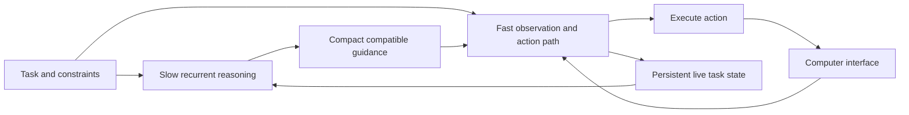

# ComputerLM research proposal

Research proposal by J.D. Krasnick. Published 10 November 2026.

**Goal:** complete easy and medium computer tasks faster and more cheaply while maintaining comparable task success.

This document publishes the research direction. It is not a trained model release or a demonstrated performance improvement. The full integrated architecture remains untrained and unvalidated. A separate development prototype exercises recurrent computation, but does not establish persistent task memory or end-to-end computer-use gains.

## Motivation

Computer interaction combines decisions of very different difficulty. Understanding constraints and choosing an approach may require substantial reasoning, while many subsequent interactions simply execute that approach. Repeatedly placing expensive inference on the action path can add avoidable latency and computation.

Three questions motivate this work:

1. Can useful reasoning continue while applications load or actions execute?
2. Can a deeper decision guide several inexpensive actions instead of requiring a new expensive decision for each interaction?
3. Can an evolving task representation preserve progress without repeatedly processing the complete interaction history?

These are limitations to investigate in common interaction loops, not claims that all existing systems lack planning, memory, or efficiency optimizations.

## Proposed architecture

One integrated model has independently executable fast and slow paths, trained to communicate through compact learned representations.

- **Fast path:** observes the interface, updates live state, predicts short action consequences, and selects grounded actions or waits.
- **Slow path:** reasons throughout an active task using persistent memory, incorporating new events at defined update boundaries and publishing guidance for the current subgoal and bounded contingencies.
- **Computer connector:** executes clicks, typing, scrolling, and other declared operations, then returns observations and execution receipts.
- **Compatibility checks:** prevent guidance or predictions based on invalid assumptions from overriding newer evidence.

The goal, state, and next action have different roles. The goal defines the desired outcome and constraints. State represents what is currently known, completed, pending, or uncertain. Actions advance the task using both. Their difficulty varies within a workflow.

## Persistent task state

Each interaction updates an existing learned representation. The fast path maintains current interface belief; the slow path retains useful reasoning across interactions. Explicit records preserve exact instructions, values, pending effects, and evidence references alongside learned memory.

For example, clicking Save marks an outcome as pending. Confirmation changes it to completed; an error revises the state. An issued action is not evidence that its intended effect occurred.

Routine updates use bounded recent context and persistent memory. Older observations remain available for retrieval rather than being discarded or replayed wholesale. State survives an explicit pause and resume, and resets for unrelated tasks. The same model can handle different tasks with separate task-local states.

Within-task memory recurrence is distinct from repeating shared model blocks for additional latent reasoning depth. The former carries information across interactions; the latter spends additional computation deliberating. Both are part of the proposed direction, but they do not have identical efficiency effects.

## Prediction and asynchronous execution

Before selecting an action, short action-conditioned predictions help compare likely consequences. While the application responds, the model can prepare for likely next states. Actual observations confirm or correct those predictions before dependent actions proceed.

Deep reasoning continues while routine execution uses compatible guidance. Unexpected transitions or unresolved prerequisites can require a wait. Predictions never substitute for observing whether an action succeeded.

Initial scope excludes unbounded branching search. The slow path must not monopolize the compute or memory bandwidth needed by the fast path.

## Expected efficiency gains

The hypothesis is that a deeper decision can support several inexpensive actions, and that persistent state reduces repeated history processing. These mechanisms aim to reduce total computation and cost. Overlapping useful reasoning with environment activity separately aims to reduce elapsed time.

Parallelism alone does not reduce computation. Continuous slow reasoning, memory updates, mistaken predictions, and recovery all incur costs. Savings must be demonstrated against strong optimized baselines, including small specialized models and systems with external memory.

## Evaluation

The primary comparison is end-to-end completion time at comparable independently verified task success on a fixed easy/medium task set. Report total compute and cost separately, including both paths, memory, prediction, and recovery overhead.

- Measure success versus elapsed time, and timing on the same tasks completed successfully by each system.
- Keep application tasks, observation access, hardware, serving settings, and outcome checks comparable.
- Separate actor timing from post-episode qualitative grading and infrastructure failures.
- Compare a sequential baseline, an asynchronous fast/slow baseline without prediction, and the full proposal.
- Ablate persistent memory, recurrence, and predictive preparation to distinguish their contributions.

No speedup, compute saving, reliability improvement, or architectural novelty is claimed as an established result.

## Research foundations

These works motivate components; results do not transfer automatically to this proposal.

- [Recurrent Memory Transformer](https://arxiv.org/abs/2207.06881): learned memory across sequence segments.
- [Scaling Transformer to 1M tokens and beyond with RMT](https://arxiv.org/abs/2304.11062): recurrent memory and linear compute scaling for long inputs.
- [Retentive Network](https://arxiv.org/abs/2307.08621): recurrent inference with costs independent of history length in its architecture.
- [UI-TARS](https://arxiv.org/abs/2501.12326): specialized visual perception, grounding, and GUI interaction.
- [ShowUI](https://arxiv.org/abs/2411.17465): lightweight vision-language-action modeling for interfaces.
- [OSWorld-Human](https://arxiv.org/abs/2506.16042): latency and action efficiency in computer-use systems.
- [CUA-Speedrun](https://arxiv.org/abs/2609.40284): standardized evaluation of task time, score, and cost.
- [PASTE](https://arxiv.org/abs/2603.18897): overlapping speculative tool execution with generation.

Fast/slow computation, recurrence, memory, and prediction each have substantial prior work. The research question is whether their learned integration improves the speed, cost, and reliability tradeoff for the selected workflows.

## Relationship to implementation

The detailed [architecture](architecture-v1.md) defines state ownership, event boundaries, prediction correction and execution. The [implementation plan](implementation-plan.md) describes the staged curriculum, controls and remaining work. The [research map](research.md) separates relevant prior mechanisms from transfer hypotheses.

The initial slow-path direction adapts Qwen3.8-27B into an encoder, shared recurrent middle, and decoder/readout, retaining pretrained weights where possible. The fast path may reuse adapted blocks or use a narrower recurrent controller. Exact partitions, memory widths, parameter sharing, training budgets, losses and hardware layout remain experimental choices.

The intended deliverable is trained weights/configuration, a runtime that supports recurrence and asynchronous updates, and a connector to the computer. A diagram or ordinary prompt-based two-model loop does not establish that this deliverable exists.
